<div align="center">

# 🏠 Patrimônio Imob

**Gestão do patrimônio imobiliário pessoal, com foco no Sul do Brasil (RS, SC e PR).**
Imóveis, co-proprietários, avaliações e um dashboard com valor estimado, valorização e IPTU.


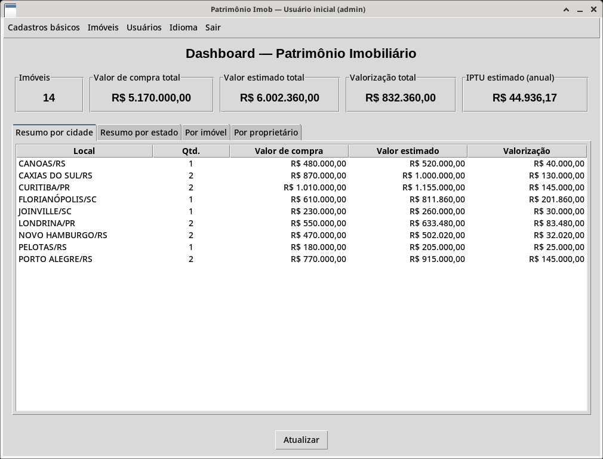

</div>

---

## 📑 Sumário

- [Funcionalidades](#-funcionalidades)
- [Telas](#-telas)
- [Arquitetura MVC + DAO](#-arquitetura-mvc--dao)
- [Banco de dados](#-banco-de-dados)
- [Como calcula valor e IPTU](#-como-calcula-valor-e-iptu)
- [Como executar](#-como-executar)
- [Documentação](#-documentação)
- [Autor](#-autor)

---

## ✨ Funcionalidades

| | Funcionalidade | Detalhe |
|---|---|---|
| 🔐 | Login | Usuário + senha guardada em hash; sem tipos de usuário |
| 🗂️ | Cadastros básicos | Estados, cidades (cascata estado → cidade), tipos e status de imóvel |
| 👥 | Proprietários | Nome obrigatório; CPF, e-mail, telefone e cidade opcionais |
| 🏢 | Imóveis | Áreas, compra, cômodos, vagas, status; área privativa ≤ área total |
| 🤝 | Co-propriedade (N:N) | Vários donos por imóvel; soma dos percentuais ≤ 100% |
| 📈 | Histórico | Avaliações, despesas e movimentações de cada imóvel |
| 📊 | Dashboard | Totais + abas por cidade, por estado, por imóvel (com IPTU) e por proprietário (parte de cada dono) |
| 🧮 | Referências | Valor do m² e alíquota de IPTU por cidade + tipo |
| 🌐 | Idioma | Português e inglês, trocados pelo menu |

**Dados da demo** (`app/migrations/dados_iniciais.sql`): 3 estados, 11 cidades, 4 tipos, 3 status, 5 proprietários fictícios e 14 imóveis (4 apartamentos, 3 casas, 3 terrenos e 4 salas comerciais) em 9 cidades, com co-propriedade e histórico.

| UF | Cidades |
|:---:|---|
| RS | Porto Alegre, Caxias do Sul, Canoas, Pelotas, Novo Hamburgo, Campo Bom |
| SC | Florianópolis, Joinville, Balneário Camboriú |
| PR | Curitiba, Londrina |

Imóveis só nas cidades com alíquota de IPTU conferida em fonte oficial (fonte em comentário no SQL). Campo Bom e Balneário Camboriú entram só como cidade, sem alíquota. O m² é o valor médio de referência de mercado para venda residencial (ago/2026): veja o 🏙️ [ranking do m² no Sul](docs/ranking_m2.md).

---

## 🖼️ Telas

| Login | Dashboard — por imóvel (IPTU) |
|:---:|:---:|
| 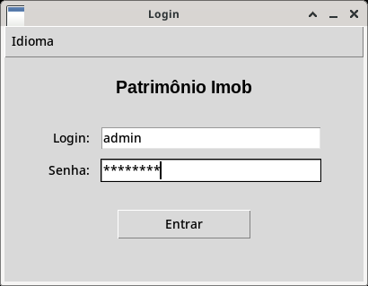 | 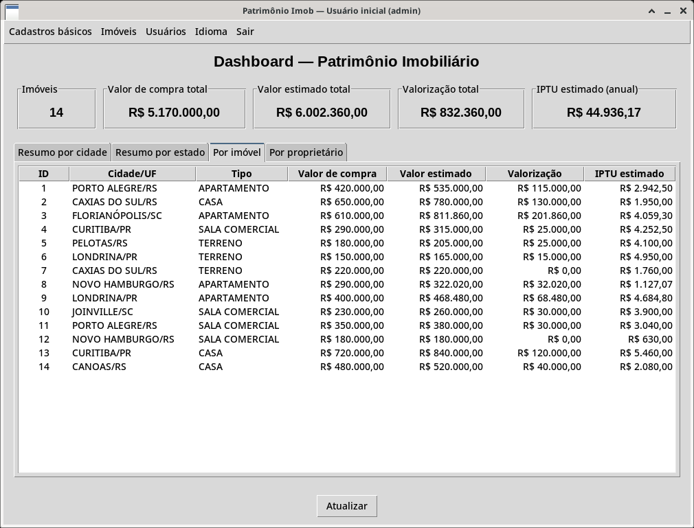 |
| **Imóveis — cascata estado → cidade** | **Proprietários do imóvel (N:N)** |
| 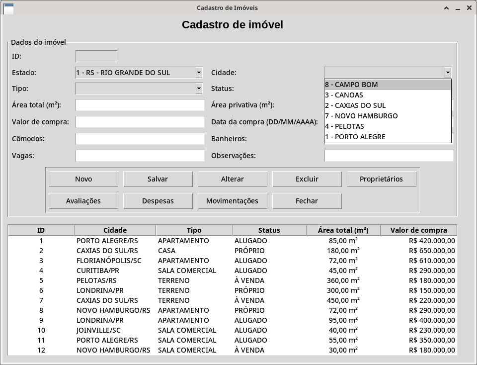 | 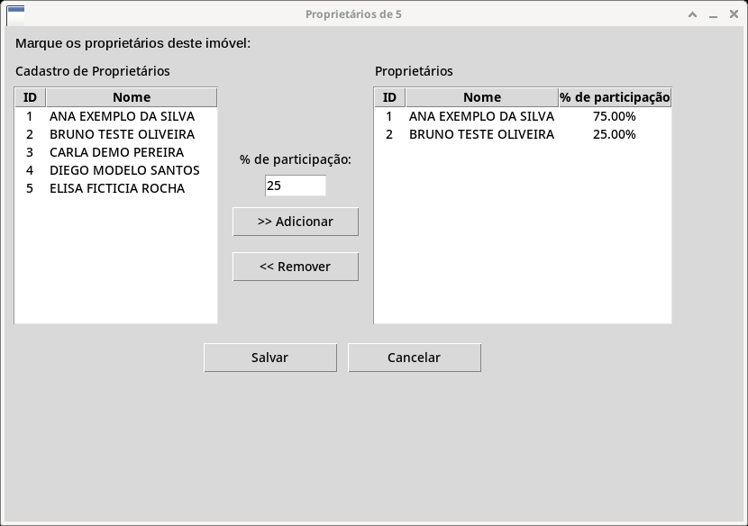 |
| **Soma acima de 100% bloqueada** | **Avaliações do imóvel** |
| 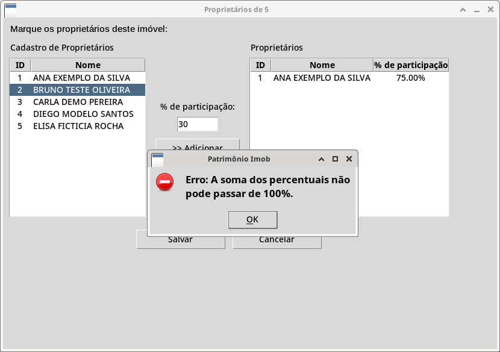 | 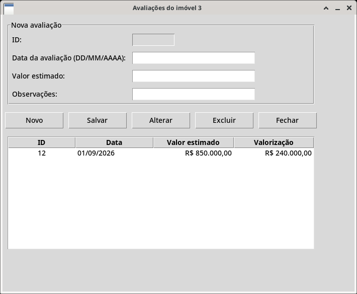 |
| **Dashboard — por proprietário** | **Dashboard em inglês** |
| 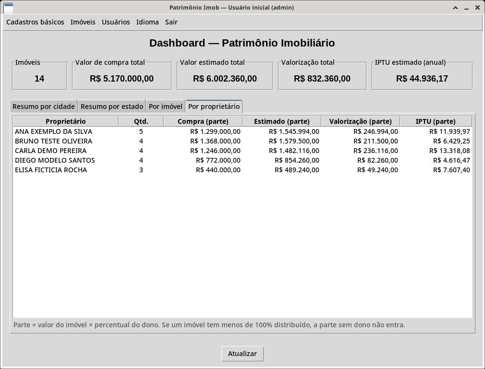 | 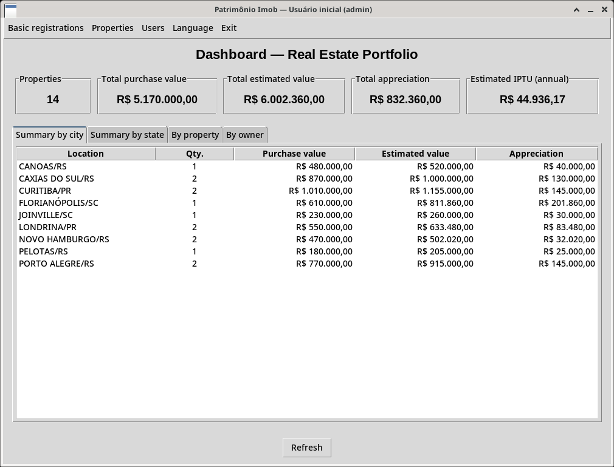 |

---

## 🧱 Arquitetura MVC + DAO

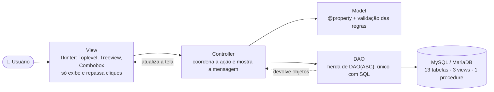

| Pasta | Papel |
|---|---|
| `app/models/` | Uma classe por tabela; encapsulamento com `@property`; `ValueError` quando a regra falha |
| `app/dao/` | `dao.py` é a base abstrata (`save`, `get_all`, `get_by_id`, `update`, `delete`); só aqui tem SQL |
| `app/controllers/` | Liga a tela aos dados; um método por ação (salvar, alterar, excluir…) |
| `app/views/` | Uma tela por entidade: formulário + `Treeview`; popups em `Toplevel` |
| `app/core/` | `database.py` (conexão), `idioma.py` (PT/EN), `data_utils.py` (datas e formatação), `relatorio.py` (cálculos), `senha_utils.py` (hash) |
| `app/migrations/` | Script único, views/procedure, dados da demo e 1 create/add por tabela |

---

## 🗄️ Banco de dados

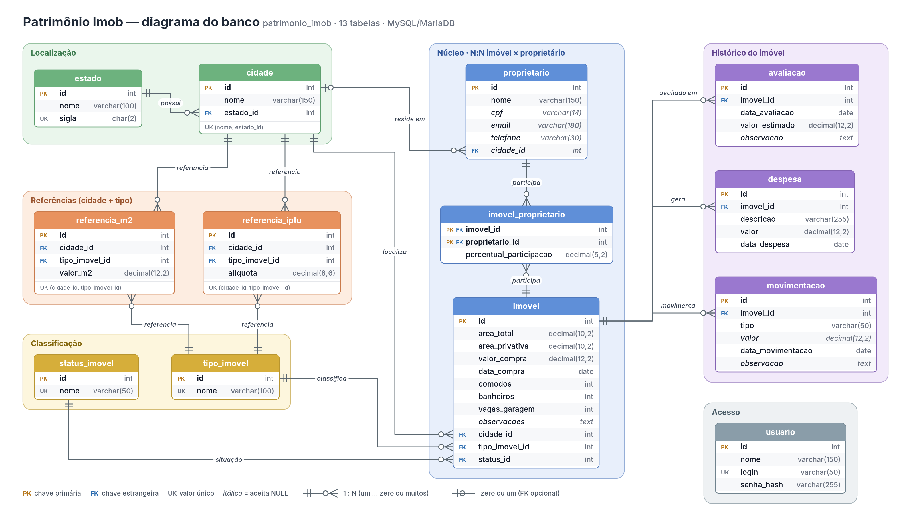

*Diagrama ER: as 13 tabelas em 6 grupos, com PK/FK, tipos e cardinalidade (pé de galinha). As views estão em [docs/diagrama_banco.md](docs/diagrama_banco.md).*

- **1:N:** estado → cidade → imóvel; imóvel → avaliações, despesas e movimentações.
- **N:N:** imóvel × proprietário pela classe associativa `imovel_proprietario` (com o percentual).
- **Sem `ON DELETE CASCADE`:** o banco impede apagar registro em uso ("existem registros vinculados").
- **Views:** `VW_IMOVEL_DETALHADO`, `VW_PATRIMONIO_POR_CIDADE` (aba *Por cidade*) e `VW_RESUMO_POR_PROPRIETARIO` (aba *Por proprietário*). **Procedure:** `SP_ADICIONAR_PROPRIETARIO` (barra soma > 100% com `SIGNAL SQLSTATE '45000'`).

Detalhes em [docs/diagrama_banco.md](docs/diagrama_banco.md).

---

## 🧮 Como calcula valor e IPTU

1. **Valor estimado** = última avaliação → senão área privativa × valor do m² → senão valor de compra.
2. **Valorização** = valor estimado − valor de compra.
3. **IPTU estimado** = valor estimado × alíquota (cidade + tipo). A alíquota é guardada como **fração**: `0.0055` = 0,55%. Sem alíquota cadastrada, o IPTU fica R$ 0,00.

| Imóvel | Base | Alíquota | IPTU estimado |
|---|---|---:|---:|
| 1 · Apartamento, Porto Alegre | avaliação R$ 535.000,00 | 0,55% | **R$ 2.942,50** |
| 3 · Apartamento, Florianópolis | 60 m² × 13.531 = R$ 811.860,00 | 0,50% | **R$ 4.059,30** |

Com os 14 imóveis da demo: compra **R$ 5.170.000,00** · estimado **R$ 6.002.360,00** · valorização **R$ 832.360,00** · IPTU **R$ 44.936,17**.

Na aba *Por proprietário*, cada valor é multiplicado pelo percentual do dono (ex.: imóvel 13, R$ 840.000,00, 50% Ana e 50% Carla → R$ 420.000,00 para cada).

> É uma estimativa: o IPTU real usa o valor venal da prefeitura, faixas, descontos e isenções.

---

## 🚀 Como executar

Windows + XAMPP + MySQL Workbench. Precisa de **Python 3.10 ou mais novo** (no instalador, marque *Add python.exe to PATH*), XAMPP, MySQL Workbench e Git.

> **Tcl/Tk?** É a biblioteca gráfica que o Tkinter usa para desenhar as janelas. Ela já vem no instalador do Python para Windows (opção *tcl/tk and IDLE*, marcada por padrão): não há nada para instalar à parte.

1. No *XAMPP Control Panel*, clique em **Start** no **MySQL** (fica verde).
2. Clone e entre na pasta: `git clone https://github.com/ThomasRhoden/patrimonio-imob.git` e `cd patrimonio-imob`
3. Ambiente virtual: `python -m venv .venv` e `.\.venv\Scripts\Activate.ps1`
4. Dependências: `python -m pip install -r requirements.txt`
5. Configuração: `copy .env.example .env` (já vem com o padrão do XAMPP: `root`, sem senha, `localhost`, `3306`).
6. Banco, no **MySQL Workbench**:
   - Conecte em `localhost`, porta `3306`, usuário `root`, senha em branco (use a conexão *Local instance* ou crie uma no **+** ao lado de *MySQL Connections*). Se avisar que o servidor é incompatível, é porque o XAMPP usa MariaDB: clique em **Continue Anyway**.
   - Para cada arquivo de `app/migrations/`, **nesta ordem**: *File → Open SQL Script…* → escolha o arquivo → clique no **raio** (⚡ *Execute*) → confira no painel *Output* que não há nenhum ❌ vermelho. Na primeira execução aparecem avisos amarelos ⚠️ como `1305 PROCEDURE ... does not exist` ou `DATABASE ... doesn't exist`: são normais (o script tenta apagar antes de criar).
     1. `patrimonio_imob_full.sql` (cria o banco e as 13 tabelas; apaga o banco se já existir)
     2. `views_procedures.sql` (3 views e 1 procedure; o Workbench entende o `DELIMITER $$`, não precisa mudar nada)
     3. `dados_iniciais.sql` (dados da demo)
7. Primeiro acesso: `python seed_inicial.py` (pede o login, Enter aceita `admin`, e a senha duas vezes).
8. Rodar: `python main.py` e entrar com esse login e senha. O dashboard deve mostrar **14 imóveis** e **IPTU estimado R$ 44.936,17**.

<details>
<summary>🛠️ Problemas comuns</summary>

| Sintoma | Solução |
|---|---|
| *Entrar* não faz nada | MySQL desligado no XAMPP ou falta o `.env` |
| `No module named tkinter` | Python instalado sem Tcl/Tk: instalador do Python → *Modify* → marque *tcl/tk and IDLE* |
| Erro de tabela/view inexistente | Rode os 3 scripts de novo, na ordem |
| PowerShell bloqueia o `Activate.ps1` | `Set-ExecutionPolicy -Scope CurrentUser RemoteSigned` (uma vez) |
| Esqueceu a senha | `python seed_inicial.py` com outro login (ex.: `admin2`), entre e troque a senha em *Usuários* |

</details>

<details>
<summary>⚙️ Arquivo <code>.env</code> (não versionado)</summary>

```env
DB_HOST=localhost
DB_PORT=3306
DB_USER=root
DB_PASSWORD=
DB_NAME=patrimonio_imob
```
</details>

---

## 📚 Documentação

| Documento | Conteúdo |
|---|---|
| 📋 [requisitos.md](docs/requisitos.md) | Requisitos funcionais, não funcionais e regras de negócio |
| 👤 [stakeholders.md](docs/stakeholders.md) | Stakeholders, personas e LGPD |
| 🎯 [casos_de_uso.md](docs/casos_de_uso.md) | Diagrama e fluxos dos casos de uso |
| 🧭 [matriz_moscow.md](docs/matriz_moscow.md) | Priorização MoSCoW |
| 🗒️ [backlog.md](docs/backlog.md) | Épicos e histórias de usuário |
| 🗄️ [diagrama_banco.md](docs/diagrama_banco.md) | Modelo do banco, views e procedure |
| ✅ [casos_de_teste.md](docs/casos_de_teste.md) | Casos de teste com resultado esperado |
| 🎤 [roteiro_apresentacao.md](docs/roteiro_apresentacao.md) | Roteiro da demo |
| 🏙️ [ranking_m2.md](docs/ranking_m2.md) | Ranking do m² nas cidades do Sul |
| 🕒 [linha_do_tempo_commits.md](docs/linha_do_tempo_commits.md) | Etapas de commits de referência |
| 🌐 [pism_preenchimento.md](docs/pism_preenchimento.md) | Textos para o site do PISM |
| 🖥️ [Slides (.pptx)](docs/apresentacao_patrimonio_imob.pptx) · [PDF](docs/apresentacao_patrimonio_imob.pdf) | Apresentação |

---

## 👨‍💻 Autor

**Thomas Gonçalves** · SENAC · Técnico em Desenvolvimento de Sistemas · Projeto Integrador (PISM)

Projeto acadêmico: proprietários, CPFs e e-mails da demo são fictícios.
