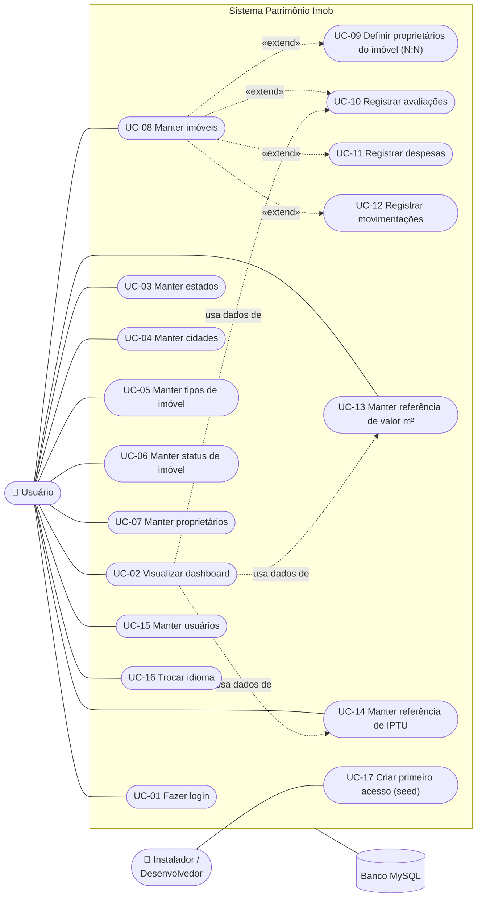

# 🎯 Casos de uso — Patrimônio Imob

Documento da UC1 (Requisitos). Os casos de uso descrevem **o que o sistema faz hoje**, conferido no código (`main.py`, `app/controllers`, `app/views`, `app/models`). Quando algo do `requisitos.md` não está implementado, isso aparece em **Observações**.

## 1. Atores

| Ator | Tipo | Descrição |
|------|------|-----------|
| **Usuário** | Principal | Quem tem um acesso (login + senha) na tabela `usuario`, normalmente o próprio dono do patrimônio. Faz todas as operações das telas. **Não há tipos de usuário** (nem admin): o sistema é pessoal e offline e o login serve só para proteger com senha |
| **Instalador / Desenvolvedor** | Principal (fora da interface) | Prepara o ambiente: banco, `.env`, `seed_inicial.py` |
| **Banco MySQL** | Secundário | Guarda os dados e garante as FKs e `unique` |

## 2. Diagrama de casos de uso

> O Mermaid não tem um diagrama de casos de uso UML próprio. Por isso foi usado um *flowchart*: os atores ficam fora do retângulo do sistema e os casos de uso dentro.

**Leitura do diagrama:**
- **UC-09 a UC-12** só podem ser usados a partir da tela de **Imóveis**, com um imóvel selecionado. Por isso aparecem como `«extend»` de UC-08.
- O **dashboard** (UC-02) usa os dados da última avaliação (UC-10) ou, se não houver, da referência de m² (UC-13) para calcular o valor estimado, e a alíquota da referência de IPTU (UC-14) para o IPTU estimado. É uma dependência de dados, não um `«include»` UML.
- Não há ator **Administrador**: todo usuário logado faz todos os casos de uso, inclusive o UC-15.

## 3. Lista de casos de uso

| ID | Caso de uso | Ator | RF / RN ligados |
|----|-------------|------|-----------------|
| UC-01 | Fazer login | Usuário | RNF (segurança), LGPD |
| UC-02 | Visualizar dashboard | Usuário | RF03, RF04, RF05, RN01, RN02, RN03 |
| UC-03 | Manter estados | Usuário | RN04 (base) |
| UC-04 | Manter cidades | Usuário | RN04 |
| UC-05 | Manter tipos de imóvel | Usuário | RN04 |
| UC-06 | Manter status de imóvel | Usuário | RN05 |
| UC-07 | Manter proprietários | Usuário | RF07 |
| UC-08 | Manter imóveis | Usuário | RF01, RF02, RF06, RN04, RN06, RN07, RN08 |
| UC-09 | Definir proprietários do imóvel | Usuário | RF07, RN04, RN09 |
| UC-10 | Registrar avaliações | Usuário | RF08, RN03 |
| UC-11 | Registrar despesas | Usuário | RF09 |
| UC-12 | Registrar movimentações | Usuário | RF10 |
| UC-13 | Manter referência de valor m² | Usuário | RF03, RN01 |
| UC-14 | Manter referência de IPTU | Usuário | RF04, RN02 |
| UC-15 | Manter usuários (acessos) | Usuário | Extra (segurança) |
| UC-16 | Trocar idioma | Usuário | Extra |
| UC-17 | Criar primeiro acesso | Instalador | Extra (implantação) |

> "Manter" = cadastrar (**Salvar**), listar, selecionar na tabela, **Alterar** e **Excluir**. Todas as telas de cadastro seguem o mesmo padrão: formulário em cima, tabela (Treeview) embaixo e os botões Novo / Salvar / Alterar / Excluir / Fechar.
>
> **Regras comuns a todas as telas de cadastro:**
> - As validações ficam nos **models** e valem no **Salvar** e no **Alterar**. Os erros aparecem como "Erro: " + mensagem.
> - **Novo**, um **Salvar** com sucesso e a reabertura da janela limpam o registro selecionado. **Alterar** ou **Excluir** sem selecionar mostra "Selecione … na lista."
> - Excluir um registro usado por outro (FK) mostra "Erro: Não é possível excluir: existem registros vinculados."; um registro repetido (`unique`) mostra "Erro: Já existe um registro com esses dados."
> - Texto em campo numérico ou data fora de `DD/MM/AAAA` (dia/mês/ano) mostra uma mensagem amigável, no idioma escolhido, com o nome do campo.
> - As comboboxes recarregam do banco quando são abertas.

---

## 4. Descrição dos casos de uso

### UC-01 — Fazer login

| Item | Descrição |
|------|-----------|
| **Ator** | Usuário |
| **Pré-condições** | MySQL ligado, banco criado e pelo menos um usuário cadastrado (ex.: o acesso `admin` criado pelo UC-17) |
| **Fluxo principal** | 1. O sistema abre a janela **Login**. 2. O usuário digita **Login** e **Senha**. 3. Clica em **Entrar** (ou aperta Enter). 4. O sistema busca o usuário pelo login e compara o hash da senha. 5. O sistema troca a janela pelo menu principal e pelo **Dashboard**, com o título "Patrimônio Imob — *nome* (*login*)" |
| **Fluxos alternativos** | **A1 – campo vazio:** mostra "Informe login e senha.". **A2 – login não existe ou senha errada:** mostra "Login ou senha inválidos." (a mensagem é a mesma nos dois casos, para não revelar qual está errado) |
| **Pós-condição** | Usuário autenticado; vê o menu completo (todos os usuários veem as mesmas telas) |
| **RF / RN** | RNF de segurança; LGPD (senha só como hash) |
| **Observações** | Não há perfis. No MySQL/MariaDB o login não diferencia maiúsculas de minúsculas (`Admin` = `admin`). Não há bloqueio após várias tentativas erradas |

### UC-02 — Visualizar dashboard

| Item | Descrição |
|------|-----------|
| **Ator** | Usuário |
| **Pré-condições** | Login feito (UC-01) |
| **Fluxo principal** | 1. Logo depois do login, o sistema calcula e mostra os indicadores: **Imóveis** (quantidade), **Valor de compra total**, **Valor estimado total**, **Valorização total** e **IPTU estimado (anual)**. 2. Mostra as abas **Resumo por cidade** e **Resumo por estado** (local, quantidade, valor de compra, valor estimado e valorização) a aba **Por imóvel** (ID, Cidade/UF, Tipo, valor de compra, valor estimado, valorização e IPTU estimado) e a aba **Por proprietário** (a parte de cada dono: valores × percentual de participação). 3. O usuário clica em **Atualizar** para recalcular depois de cadastrar dados |
| **Fluxos alternativos** | **A1 – sem imóveis:** os indicadores ficam zerados (quantidade 0, R$ 0,00). **A2 – imóvel sem avaliação e sem referência de m²:** o valor estimado desse imóvel passa a ser o próprio valor de compra, então a valorização dele é zero. **A3 – sem alíquota de IPTU para a cidade e o tipo:** o IPTU estimado desse imóvel é R$ 0,00 |
| **Pós-condição** | Indicadores mostrados (só leitura) |
| **RF / RN** | RF03; RF04; RF05; RN01 (valor estimado = área privativa × valor do m²); RN02 (IPTU = valor estimado × alíquota); RN03 (valorização = estimado − compra) |
| **Observações** | Regra do código para o valor estimado de cada imóvel: (1) a **última avaliação** registrada; senão (2) **área privativa × valor m²** da referência da cidade e tipo; senão (3) o valor de compra. Isso vai além da RN01, que fala só da referência. O dashboard **não atualiza sozinho**: é preciso clicar em **Atualizar**. O IPTU usa `Referencia_Iptu_DAO.get_by_cidade_e_tipo` e `Relatorio.calcular_iptu_estimado`, chamados pelo `Dashboard_Controller` |

### UC-03 — Manter estados

| Item | Descrição |
|------|-----------|
| **Ator** | Usuário |
| **Pré-condições** | Login feito |
| **Fluxo principal** | 1. Menu **Cadastros básicos → Estados**. 2. O usuário preenche **Nome** e **Sigla** e clica em **Salvar**. 3. O sistema grava e mostra "Estado cadastrado com sucesso!". 4. O estado aparece na lista (nome e sigla em maiúsculas) |
| **Fluxos alternativos** | **A1 – alterar:** seleciona na lista, muda os dados, clica em **Alterar**, e o sistema mostra "Estado atualizado com sucesso!". **A2 – sigla diferente de 2 letras (Salvar ou Alterar):** "Erro: A sigla deve possuir exatamente 2 caracteres."; nome vazio: "Erro: O nome é obrigatório.". **A3 – excluir:** seleciona, clica em **Excluir** e confirma; o sistema mostra "Estado excluído com sucesso!". **A4 – excluir estado com cidades:** o banco bloqueia (FK) e o sistema mostra "Erro: Não é possível excluir: existem registros vinculados.". **A6 – sigla repetida:** "Erro: Já existe um registro com esses dados." **A5 – Alterar/Excluir sem selecionar:** "Selecione um estado na lista." |
| **Pós-condição** | Estado gravado, alterado ou removido |
| **RF / RN** | Base para RN04 |
| **Observações** | A sigla é gravada sem espaços e em maiúsculas |

### UC-04 — Manter cidades

| Item | Descrição |
|------|-----------|
| **Ator** | Usuário |
| **Pré-condições** | Pelo menos um estado cadastrado (UC-03) |
| **Fluxo principal** | 1. Menu **Cadastros básicos → Cidades**. 2. Preenche o **Nome** e escolhe o **Estado** na combobox. 3. **Salvar**, e o sistema mostra "Cidade cadastrada com sucesso!". 4. A lista mostra cidade e "UF - Estado" |
| **Fluxos alternativos** | **A1 – sem estado:** "Erro: Selecione o estado.". **A2 – alterar / excluir:** como no UC-03 ("Cidade atualizada/excluída com sucesso!"). **A3 – excluir cidade usada por imóvel, proprietário ou referência:** bloqueado pela FK: "Erro: Não é possível excluir: existem registros vinculados." |
| **Pós-condição** | Cidade ligada a exatamente um estado |
| **RF / RN** | RN04 |
| **Observações** | A combobox de estados recarrega do banco quando é aberta, então um estado criado com a janela aberta já aparece |

### UC-05 — Manter tipos de imóvel

| Item | Descrição |
|------|-----------|
| **Ator** | Usuário |
| **Pré-condições** | Login feito |
| **Fluxo principal** | 1. **Cadastros básicos → Tipos de imóvel**. 2. Digita o **Nome** (ex.: Apartamento). 3. **Salvar**, e o sistema mostra "Tipo de imóvel cadastrado com sucesso!" |
| **Fluxos alternativos** | **A1 – alterar:** "Tipo de imóvel atualizado com sucesso!". **A2 – excluir:** "Tipo de imóvel excluído com sucesso!". **A3 – excluir tipo em uso:** "Erro: Não é possível excluir: existem registros vinculados.". **A4 – nome vazio:** "Erro: O nome é obrigatório."; nome repetido: "Erro: Já existe um registro com esses dados." |
| **Pós-condição** | Tipo disponível para imóveis e referências |
| **RF / RN** | RN04 |

### UC-06 — Manter status de imóvel

| Item | Descrição |
|------|-----------|
| **Ator** | Usuário |
| **Pré-condições** | Login feito |
| **Fluxo principal** | 1. **Cadastros básicos → Status de imóvel**. 2. Cadastra os status (ex.: Próprio, Alugado, À venda). 3. **Salvar**, e o sistema mostra "Status cadastrado com sucesso!" |
| **Fluxos alternativos** | Como no UC-05 ("Status atualizado com sucesso!" / "Status excluído com sucesso!") |
| **Pós-condição** | Status disponível na tela de imóveis |
| **RF / RN** | RN05: o status é um cadastro configurável, não fixo no código |
| **Observações** | O script da estrutura não cria status; os três da RN05 (Próprio, Alugado, À venda) vêm do `dados_iniciais.sql` e podem ser alterados por esta tela |

### UC-07 — Manter proprietários

| Item | Descrição |
|------|-----------|
| **Ator** | Usuário |
| **Pré-condições** | Para informar a cidade, é preciso ter estado e cidade cadastrados |
| **Fluxo principal** | 1. **Cadastros básicos → Proprietários**. 2. Preenche **Nome** e, se quiser, **CPF**, **E-mail**, **Telefone**. 3. Escolhe o **Estado**; a combobox **Cidade** é recarregada só com as cidades daquele estado (cascata). 4. Escolhe a cidade. 5. **Salvar**, e o sistema mostra "Proprietário cadastrado com sucesso!" |
| **Fluxos alternativos** | **A1 – sem cidade:** permitido (cidade é opcional). **A2 – alterar:** "Proprietário atualizado com sucesso!". **A3 – excluir:** "Proprietário excluído com sucesso!". **A4 – excluir proprietário ligado a imóvel:** "Erro: Não é possível excluir: existem registros vinculados.". **A5 – sem nome:** "Erro: O nome é obrigatório." |
| **Pós-condição** | Proprietário disponível no popup do UC-09 |
| **RF / RN** | RF07; LGPD (minimização: só o nome é obrigatório) |
| **Observações** | Não há validação de formato de CPF, e-mail ou telefone |

### UC-08 — Manter imóveis

| Item | Descrição |
|------|-----------|
| **Ator** | Usuário |
| **Pré-condições** | Estado, cidade, tipo e status cadastrados (as comboboxes recarregam ao serem abertas) |
| **Fluxo principal** | 1. Menu **Imóveis → Imóveis**. 2. Escolhe o **Estado**; a combobox **Cidade** mostra só as cidades dele (cascata). 3. Escolhe **Cidade**, **Tipo** e **Status**. 4. Preenche **Área total**, **Área privativa**, **Valor de compra** (número com ponto, ex.: `450000.00`), **Data da compra** (`DD/MM/AAAA`), **Cômodos**, **Banheiros**, **Vagas** e, se quiser, **Observações**. 5. **Salvar**: o model valida as regras e o sistema mostra "Imóvel cadastrado com sucesso!". 6. A lista mostra ID, Cidade/UF, Tipo, Status, Área total e Valor de compra |
| **Fluxos alternativos** | **A1 – área total ≤ 0:** "Erro: A área total deve ser maior que zero." (RN06). **A2 – privativa > total:** "Erro: A área privativa não pode exceder a área total." (RN07). **A3 – valor negativo:** "Erro: O valor de compra não pode ser negativo." (RN08). **A4 – combobox vazia:** "Erro: Selecione a cidade." / "Erro: Selecione o tipo de imóvel." / "Erro: Selecione o status.". **A5 – data em outro formato:** "Erro: Data da compra: informe a data no formato DD/MM/AAAA (ex.: 30/09/2026).". **A6 – texto onde se espera número:** "Erro: Área total (m²): informe um número válido (use ponto para decimais, ex.: 1500.50)." (cômodos, banheiros e vagas pedem número inteiro). **A10 – área privativa negativa:** "Erro: A área privativa não pode ser negativa.". **A11 – cômodos, banheiros ou vagas negativos:** "Erro: Cômodos, banheiros e vagas não podem ser negativos.". **A7 – alterar:** seleciona na lista, os campos são preenchidos (já com a cidade do estado certo), muda e clica em **Alterar**; o sistema mostra "Imóvel atualizado com sucesso!". **A8 – excluir:** confirma; "Imóvel excluído com sucesso!". **A9 – excluir imóvel com proprietários, avaliações, despesas ou movimentações:** bloqueado pela FK: "Erro: Não é possível excluir: existem registros vinculados." |
| **Pós-condição** | Imóvel gravado com cidade, tipo e status obrigatórios |
| **RF / RN** | RF01, RF02, RF06, RN04, RN06, RN07, RN08 |
| **Observações** | As regras ficam no model `Imovel` e valem no **Salvar** e no **Alterar**. Data no futuro não é bloqueada. O valor estimado e o IPTU de cada imóvel aparecem na aba **Por imóvel** do dashboard (UC-02). **Novo** limpa os campos e o imóvel selecionado, então **Alterar** depois de **Novo** pede para selecionar, e os popups (UC-09 a UC-12) sempre usam o imóvel selecionado no momento |

### UC-09 — Definir proprietários do imóvel (co-propriedade N:N)

| Item | Descrição |
|------|-----------|
| **Ator** | Usuário |
| **Pré-condições** | Imóvel selecionado na lista do UC-08 e pelo menos um proprietário cadastrado (UC-07) |
| **Fluxo principal** | 1. Clica em **Proprietários**. 2. Abre o popup "Proprietários de *ID*": à esquerda os proprietários disponíveis, à direita os já ligados ao imóvel. 3. Seleciona um proprietário, digita o **% de participação** (padrão 100) e clica em **>> Adicionar**. 4. Repete para os outros donos. 5. **Salvar**: o sistema apaga os vínculos antigos, grava os novos, mostra "Proprietários do imóvel atualizados com sucesso!" e fecha o popup |
| **Fluxos alternativos** | **A1 – sem imóvel selecionado:** "Selecione um imóvel na lista.". **A2 – nenhum proprietário cadastrado:** "Selecione um proprietário na lista.". **A3 – percentual fora de 0 a 100:** "Erro: O percentual deve estar entre 0 e 100."; não numérico: "Erro: % de participação: informe um número válido …". **A4 – soma passaria de 100%:** "Erro: A soma dos percentuais não pode passar de 100%." (RN09). **A5 – remover:** seleciona à direita e clica em **<< Remover**. **A6 – adicionar de novo um proprietário que já está na lista:** substitui o percentual dele. **A7 – Cancelar:** fecha sem gravar |
| **Pós-condição** | Linhas em `imovel_proprietario` com soma ≤ 100% |
| **RF / RN** | RF07, RN04, RN09 |
| **Observações** | A RN09 fica nos models (`Participacao_Proprietario` e `Imovel.validar_percentuais`); o popup chama essa validação ao adicionar e mostra a mensagem do model, e o setter `Imovel.proprietarios` valida de novo no **Salvar**. No banco, cada vínculo é gravado pela procedure `SP_ADICIONAR_PROPRIETARIO`, que confere a soma de novo (`SIGNAL SQLSTATE '45000'`, mostrado com a mesma mensagem). A soma **pode ficar abaixo** de 100% (nada exige 100% exato). O percentual aparece com 2 casas (ex.: `60.00%`) |

### UC-10 — Registrar avaliações

| Item | Descrição |
|------|-----------|
| **Ator** | Usuário |
| **Pré-condições** | Imóvel selecionado na tela de Imóveis |
| **Fluxo principal** | 1. Clica em **Avaliações**. 2. Abre "Avaliações do imóvel *ID*" com o histórico (mais recente primeiro). 3. Preenche **Data da avaliação** (`DD/MM/AAAA`), **Valor estimado** e **Observações**. 4. **Salvar**, e o sistema mostra "Avaliação salva com sucesso!". 5. A lista mostra Data, Valor estimado e **Valorização** (valor estimado − valor de compra) |
| **Fluxos alternativos** | **A1 – data inválida:** "Erro: Data da avaliação: informe a data no formato DD/MM/AAAA (ex.: 30/09/2026).". **A2 – alterar:** "Avaliação atualizada com sucesso!". **A3 – valor negativo (Salvar ou Alterar):** "Erro: O valor estimado não pode ser negativo.". **A4 – excluir:** confirma; "Avaliação excluída com sucesso!" |
| **Pós-condição** | A última avaliação passa a ser o valor estimado do imóvel no dashboard |
| **RF / RN** | RF08, RN03 |
| **Observações** | O construtor do model passa pelos setters, então a validação vale no **Salvar** e no **Alterar**. |

### UC-11 — Registrar despesas

| Item | Descrição |
|------|-----------|
| **Ator** | Usuário |
| **Pré-condições** | Imóvel selecionado |
| **Fluxo principal** | 1. Clica em **Despesas**. 2. Preenche **Descrição**, **Valor** e **Data** (`DD/MM/AAAA`). 3. **Salvar**, e o sistema mostra "Despesa salva com sucesso!". 4. A lista mostra Descrição, Valor e Data |
| **Fluxos alternativos** | **A1 – data inválida:** "Erro: Data: informe a data no formato DD/MM/AAAA (ex.: 30/09/2026).". **A2 – valor negativo (Salvar ou Alterar):** "Erro: O valor da despesa não pode ser negativo.". **A3 – sem descrição:** "Erro: A descrição da despesa é obrigatória.". **A4 – alterar / excluir:** "Despesa atualizada com sucesso!" / "Despesa excluída com sucesso!" |
| **Pós-condição** | Despesa ligada ao imóvel |
| **RF / RN** | RF09 |
| **Observações** | As despesas **não entram** no dashboard |

### UC-12 — Registrar movimentações

| Item | Descrição |
|------|-----------|
| **Ator** | Usuário |
| **Pré-condições** | Imóvel selecionado |
| **Fluxo principal** | 1. Clica em **Movimentações**. 2. Escolhe o **Tipo** (`entrada_aluguel`, `saida_manutencao` ou `outro`), preenche **Valor** (opcional), **Data** e **Observações**. 3. **Salvar**, e o sistema mostra "Movimentação salva com sucesso!" |
| **Fluxos alternativos** | **A1 – sem tipo:** "Erro: Selecione o tipo da movimentação.". **A2 – data inválida:** "Erro: Data: informe a data no formato DD/MM/AAAA (ex.: 30/09/2026).". **A3 – alterar / excluir:** "Movimentação atualizada com sucesso!" / "Movimentação excluída com sucesso!" |
| **Pós-condição** | Movimentação ligada ao imóvel |
| **RF / RN** | RF10 |
| **Observações** | Não há regra de sinal para o valor. As movimentações **não entram** no dashboard. Valor vazio ou 0 aparece em branco na lista |

### UC-13 — Manter referência de valor m²

| Item | Descrição |
|------|-----------|
| **Ator** | Usuário |
| **Pré-condições** | Cidade e tipo de imóvel cadastrados |
| **Fluxo principal** | 1. **Imóveis → Referência de valor m²**. 2. Escolhe **Cidade** e **Tipo**, informa o **Valor por m²**. 3. **Salvar**, e o sistema mostra "Referência de m² salva com sucesso!" |
| **Fluxos alternativos** | **A1 – sem cidade ou tipo:** "Erro: Selecione a cidade." / "Erro: Selecione o tipo de imóvel.". **A2 – valor negativo (Salvar ou Alterar):** "Erro: O valor por m² não pode ser negativo.". **A3 – segunda referência para o mesmo par cidade + tipo:** "Erro: Já existe um registro com esses dados." |
| **Pós-condição** | O dashboard passa a usar área privativa × valor m² nos imóveis sem avaliação |
| **RF / RN** | RF03, RN01 |
| **Observações** | As comboboxes de cidade e tipo recarregam ao serem abertas |

### UC-14 — Manter referência de IPTU

| Item | Descrição |
|------|-----------|
| **Ator** | Usuário |
| **Pré-condições** | Cidade e tipo cadastrados |
| **Fluxo principal** | 1. **Imóveis → Referência de IPTU**. 2. Escolhe **Cidade** e **Tipo**, informa a **Alíquota** (ex.: `0.01` = 1%). 3. **Salvar**, e o sistema mostra "Referência de IPTU salva com sucesso!". 4. A lista mostra a alíquota em % (ex.: `1%`) |
| **Fluxos alternativos** | Como no UC-13 ("Erro: A alíquota do IPTU não pode ser negativa." no **Salvar** e no **Alterar**) |
| **Pós-condição** | Alíquota gravada e usada no IPTU estimado do dashboard (UC-02) |
| **RF / RN** | RF04, RN02 |
| **Observações** | O `Dashboard_Controller` busca a alíquota com `Referencia_Iptu_DAO.get_by_cidade_e_tipo` e calcula com `Relatorio.calcular_iptu_estimado` (valor estimado × alíquota). O resultado aparece no indicador **IPTU estimado (anual)** e na aba **Por imóvel** |

### UC-15 — Manter usuários

| Item | Descrição |
|------|-----------|
| **Ator** | Usuário |
| **Pré-condições** | Login feito (qualquer acesso) |
| **Fluxo principal** | 1. Menu **Usuários → Usuários**. 2. Preenche **Login**, **Nome** e **Senha**. 3. **Salvar**: a senha é transformada em hash; o sistema mostra "Usuário salvo com sucesso!". Para **trocar a senha**: seleciona o acesso na lista, digita a senha nova e clica em **Alterar** |
| **Fluxos alternativos** | **A1 – sem senha no cadastro:** "Erro: Informe a senha.". **A2 – alterar com senha em branco:** mantém a senha atual ("Usuário atualizado com sucesso!"). **A3 – alterar com senha nova:** grava um novo hash. **A4 – login repetido:** "Erro: Já existe um registro com esses dados.". **A5 – login vazio, com espaço ou com mais de 50 caracteres:** "Erro: Informe o login: até 50 caracteres, sem espaços (ex.: admin).". **A6 – excluir o próprio acesso:** "Não é possível excluir o usuário que está logado." (assim sempre sobra um acesso) |
| **Pós-condição** | O acesso pode fazer login (UC-01) |
| **RF / RN** | Extra (não está no `requisitos.md`); LGPD (só login, nome e senha em hash) |
| **Observações** | Sem tipos de usuário: o menu **Usuários** aparece para todo usuário logado |

### UC-16 — Trocar idioma

| Item | Descrição |
|------|-----------|
| **Ator** | Usuário |
| **Pré-condições** | Sistema aberto (na tela de login ou depois do login) |
| **Fluxo principal** | 1. Menu **Idioma → English** (ou **Português**). 2. O menu principal é refeito no idioma escolhido. 3. O título, o dashboard e as janelas de cadastro abertas são refeitos no novo idioma (os popups do imóvel são fechados). 4. Todos os textos de interface vêm do dicionário `Idioma` (`pt` e `en`, com as mesmas chaves) |
| **Pós-condição** | Idioma atual trocado |
| **RF / RN** | Extra |
| **Observações** | Tradução **completa** da interface: menus, títulos, labels, botões, cabeçalhos, abas, mensagens e as opções da combobox de tipo de movimentação. A tela de login também tem o menu **Idioma**. Os **dados** cadastrados não são traduzidos e o banco guarda os códigos (ex.: `entrada_aluguel`). Dados digitados e não salvos nas janelas abertas são descartados na troca |

### UC-17 — Criar primeiro acesso (seed)

| Item | Descrição |
|------|-----------|
| **Ator** | Instalador / Desenvolvedor |
| **Pré-condições** | Banco criado com `patrimonio_imob_full.sql` e `.env` configurado (copiado de `.env.example`) |
| **Fluxo principal** | 1. No terminal: `python seed_inicial.py`. 2. O script pede o **login** (Enter aceita a sugestão `admin`). 3. Pede a senha com `getpass` (não aparece na tela) e pede para confirmar. 4. Cria o acesso "Usuário inicial" com esse login e a senha em hash, e mostra "Acesso criado com sucesso!" |
| **Fluxos alternativos** | **A1 – login já existe:** mostra "O login admin já existe. Nada a fazer." (não pede senha). **A2 – login com espaço:** avisa e pede de novo. **A3 – senha vazia ou confirmação diferente:** avisa e pede de novo |
| **Pós-condição** | É possível fazer o primeiro login |
| **RF / RN** | Extra (implantação) |
| **Observações** | O seed **só cria o acesso**. Os dados da demo vêm do `dados_iniciais.sql`. Também serve para criar outro acesso se a senha for esquecida |
